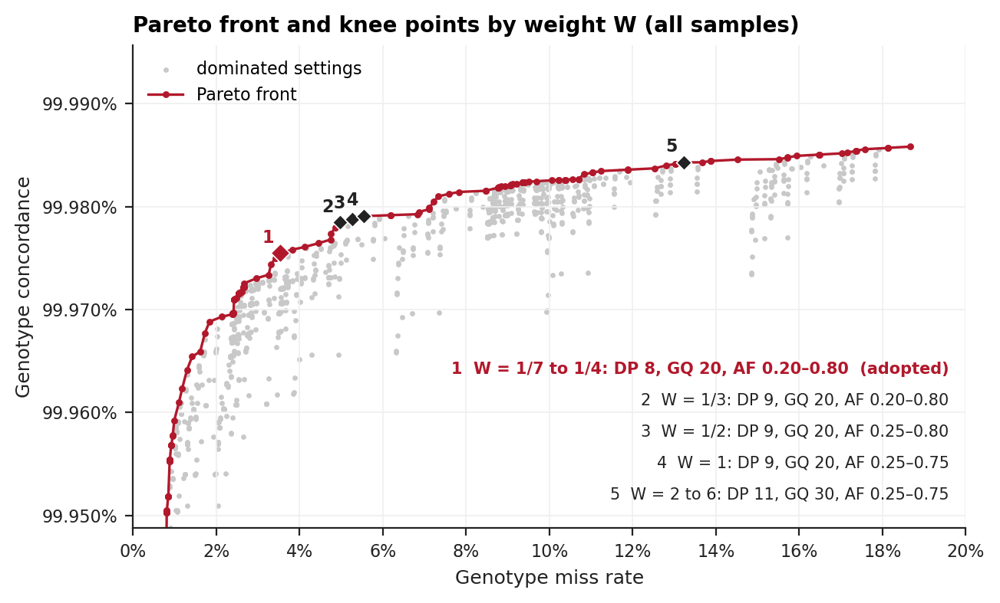
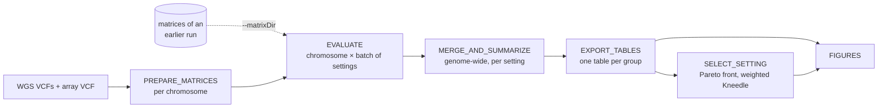
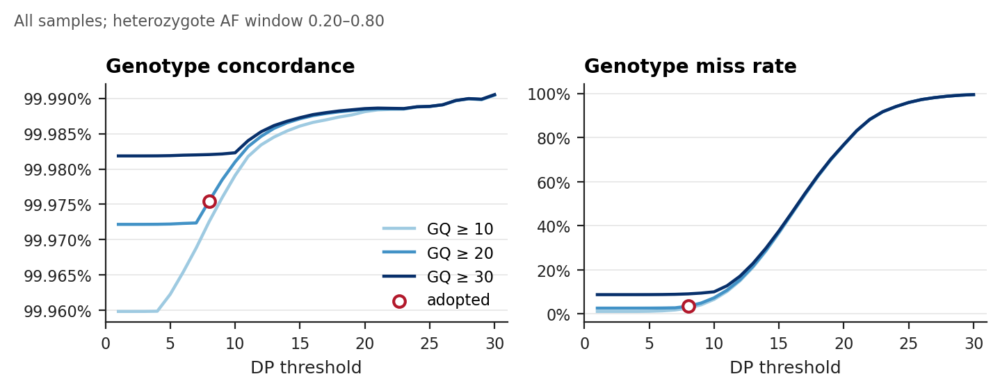
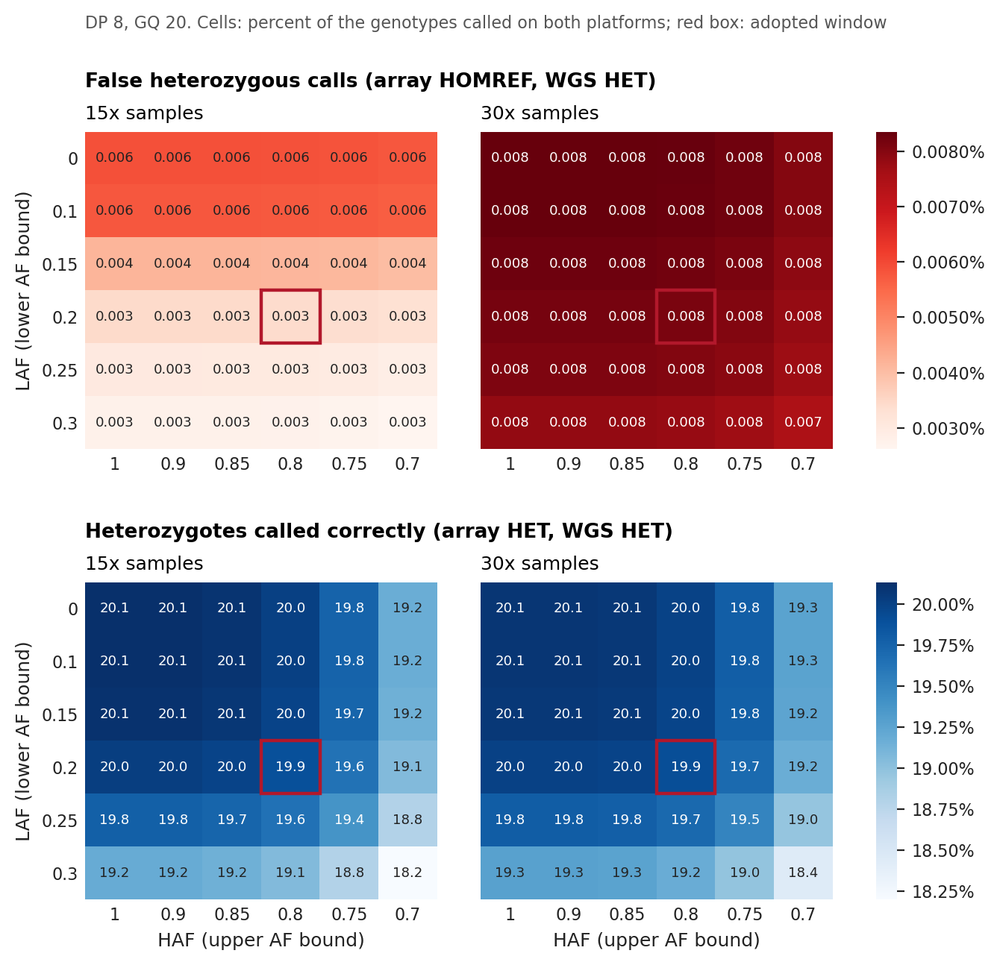
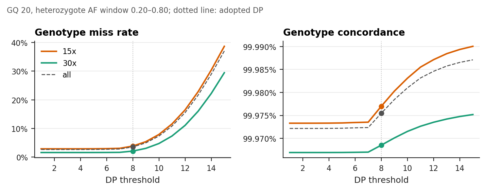

# ParetoGT

**Pareto-optimal genotype QC thresholds for whole-genome sequencing, calibrated against array genotypes.**

ParetoGT chooses genotype-level QC thresholds for WGS calls:
- read depth (DP);
- genotype quality (GQ);
- the heterozygote allele-fraction window [LAF, HAF].

It does this by measuring each candidate setting against array genotypes of the same samples. Every combination of thresholds is scored on:
- genotype concordance;
- genotype miss rate;
- false positive and false negative rates.

Scores are computed in all samples and per sequencing-depth group. The setting is then chosen on the Pareto front of concordance against miss rate, at the knee point found by a weighted Kneedle.

Version 0.2.0, under development ([CHANGELOG](CHANGELOG.md)).



## How it works



1. **Compare.** On the variants and samples shared by both platforms, each setting sets the failing WGS calls to missing:
   - DP below the threshold;
   - GQ below the threshold;
   - a heterozygous call whose allele fraction falls outside [LAF, HAF].

   The remaining calls are cross-tabulated against the array genotypes.
2. **Score.** Each confusion matrix gives concordance, miss rate, false positive and false negative rates, and the per-variant and per-sample missingness. The scores are computed in all samples (ALL) and separately at 15x and 30x.
3. **Choose.** No setting maximizes concordance and minimizes the miss rate at once. ParetoGT therefore:
   - keeps the settings on the Pareto front;
   - finds the front's knee point with Kneedle, weighted by W, the weight on concordance relative to the weight on miss rate.

   A setting that stays the knee across an interval of W is preferred.

Definitions and the selection rule: [docs/METHODS.md](docs/METHODS.md).

## Quick start

```bash
git clone <this repository> ParetoGT && cd ParetoGT

# 1. Synthetic test (two chromosomes, 84 settings, local; a few minutes)
nextflow run main.nf -profile test

# 2. A full run on SLURM: one WGS VCF per chromosome, plus the array VCF
sbatch run_nextflow.sh --wgsDir /path/to/wgs --trueVcf /path/to/array.vcf.gz --sampleInfo /path/to/depth.csv
./monitor_status.sh

# 3. Another threshold grid on matrices already prepared (skips the VCF extraction)
sbatch run_nextflow.sh --matrixDir results/01.prepare_format_matrix --dp 6-12 --gq 20,30
```

### Inputs

| Input | Parameter | Format |
|---|---|---|
| WGS calls | `--wgsDir`, `--callVcfSuffix` | one bgzipped, indexed VCF per chromosome, `<chr><suffix>`. FORMAT GT, DP, GQ and AF (alternate allele fraction). Variant IDs `chr:pos:ref:alt`. |
| Array genotypes (the truth) | `--trueVcf` | one bgzipped, indexed VCF, FORMAT GT, with the same variant IDs |
| Depth groups | `--sampleInfo` | CSV `ID,Target_DP`, with values `15x` or `30x` ([info/README.md](info/README.md)) |
| or: prepared matrices | `--matrixDir` | `01.prepare_format_matrix/` of an earlier run |

### Parameters

| Parameter | Default | Meaning |
|---|---|---|
| `--chromosomes` | `1-22` | chromosomes, as numbers or names |
| `--dp`, `--gq` | `1-30`, `10,20,30` | DP and GQ thresholds; a range is written `a-b` |
| `--laf`, `--haf` | `0.0,…,0.3`, `1.0,…,0.7` | bounds of the heterozygote allele-fraction window |
| `--weights` | `1/7,…,1,…,6` | weight ratios W scanned for the knee |
| `--adoptWeight` | `1/4` | the knee at this W is marked as adopted in the figures |
| `--combosPerTask` | `36` | settings evaluated per task; the matrices are read once per task |
| `--chromSummaries` | `true` | also write per-chromosome metrics (`03`) |
| `--publishMode` | `symlink` | how `01`–`05` are published; the tables and figures are always copied |
| `--outDir` | `results` | output folder |
| `--python`, `--bcftools` | site paths | Python 3 with the packages below, and bcftools |

SLURM resources are set per step in [nextflow.config](nextflow.config), through `--rsc` cluster options. `-profile local` runs every task on the current host.

### Outputs

| Folder | Content |
|---|---|
| `results/summary/` | `merged_summary_{all,15x,30x}.csv`: every setting with its metrics, one table per group |
| `results/selection/` | `pareto_front_{all,15x,30x}.tsv`; `knee_by_weight.tsv`, the knee of each group and W with its metrics in every group |
| `results/figures/` | the four figures shown here (PNG, PDF) |
| `results/01`–`05` | per-chromosome matrices; per-chromosome and genome-wide results of every setting (about 0.5 TB for the full grid) |
| `results/pipeline_info/` | trace, report, timeline |

## First application

**Data.**
- 1,750 samples with both WGS and array genotypes, sequenced at 15x or 30x;
- 382,521 shared autosomal variants.

**Grid.** 3,240 settings: DP 1–30 × GQ 10/20/30 × LAF 0–0.3 × HAF 0.7–1.0.

**Knee point by weight ratio W.** The metrics are for all samples ([`results/selection/knee_by_weight.tsv`](results/selection/knee_by_weight.tsv)).

| W | DP | GQ | LAF | HAF | Concordance | Miss rate |
|---|---:|---:|---:|---:|---:|---:|
| 1/7 – 1/4 | 8 | 20 | 0.20 | 0.80 | 99.975% | 3.534% |
| 1/3 | 9 | 20 | 0.20 | 0.80 | 99.978% | 4.970% |
| 1/2 | 9 | 20 | 0.25 | 0.80 | 99.979% | 5.259% |
| 1 | 9 | 20 | 0.25 | 0.75 | 99.979% | 5.551% |
| 2 – 6 | 11 | 30 | 0.25 | 0.75 | 99.984% | 13.232% |

**Adopted setting: DP ≥ 8, GQ ≥ 20, heterozygote AF in [0.20, 0.80].** It is the knee for every W from 1/7 to 1/4. Beyond that interval, small gains in concordance cost several points of miss rate.

| Group | Concordance | Miss rate | False positive rate | False negative rate |
|---|---:|---:|---:|---:|
| All | 99.975% | 3.534% | 0.013% | 0.011% |
| 15x | 99.977% | 3.842% | 0.013% | 0.010% |
| 30x | 99.969% | 2.095% | 0.017% | 0.015% |

**Threshold scan.** Concordance rises with the DP and GQ thresholds. The miss rate stays low up to DP ≈ 8 and then climbs steeply.



**Allele-fraction window.** A tighter window removes false heterozygous calls, mostly at 15x. It also costs true heterozygotes, so the window cannot simply be made as narrow as possible.



**Depth groups.** At the adopted setting, 15x and 30x samples agree on accuracy. Missingness remains the difference between them.



The slides of this application: [docs/qc.gt_tuning.v6.rev1.pptx](docs/qc.gt_tuning.v6.rev1.pptx).

## Requirements

- Nextflow 25.04 or later (DSL2). Tested with 26.04.4.
- bcftools. Tested with 1.21.
- Python 3 with the packages in [requirements.txt](requirements.txt): pandas, numpy, matplotlib, scipy, kneed. The weighted Kneedle is built into `scripts/select_setting.py` and runs on the released `kneed`.
- For the exploratory notebooks only: seaborn, tqdm, and `kneed` with [patches/kneed-0.8.5-weighted.patch](patches/kneed-0.8.5-weighted.patch).

## Testing

`-profile test` runs the whole pipeline on synthetic data in [tests/](tests/README.md): 40 simulated samples, two chromosomes and 84 settings.

Two checks support the rewrite in DSL2 and the faster evaluation:
- **Synthetic data.** For all 84 settings, the evaluation tables equal those of the original script of version 0.1.0.
- **First application (chr22, from its prepared matrices).** The tables equal those of the original run.

Both comparisons were made with [tests/compare_pickles.py](tests/compare_pickles.py), which checks values, data types and row and column order.

## Repository layout

| Path | Content |
|---|---|
| `main.nf`, `nextflow.config` | the pipeline (DSL2), its parameters, resources and profiles |
| `run_nextflow.sh`, `monitor_status.sh` | SLURM launcher of the Nextflow head, and a progress monitor |
| `scripts/` | the steps: VCF extraction, evaluation, merging, metrics, export, selection, figures |
| `notebooks/` | exploratory notebooks of the first application |
| `tests/` | synthetic test data, its generator, and the result comparison |
| `docs/` | methods, and the slides of the first application |
| `results/` | the tables, selection and figures of the first application |
| `patches/` | the weighted Kneedle as a patch to `kneed` (for the notebooks) |

The sample sheet and per-sample results are not under version control.

## Roadmap

- Sample groups other than 15x and 30x.
- Smaller intermediate files (`01`–`04`).
- A container image with the Python environment and bcftools.

## Author

Zhao Tie ([@ZhaoTie-re](https://github.com/ZhaoTie-re)), Graduate School of Medicine, Kyoto University.
